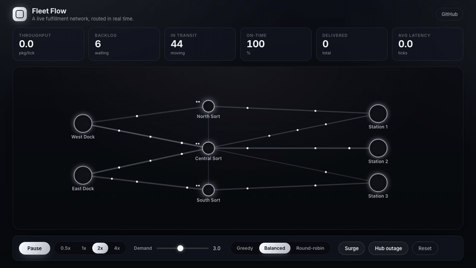
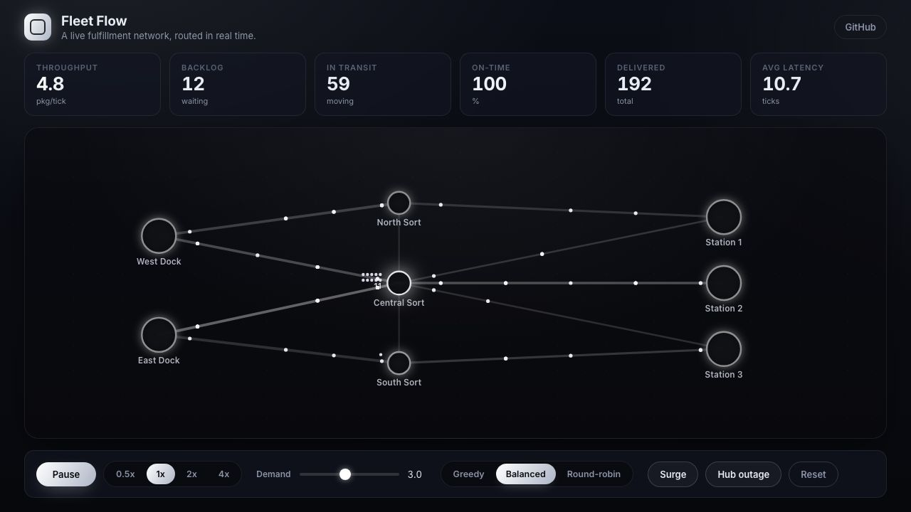
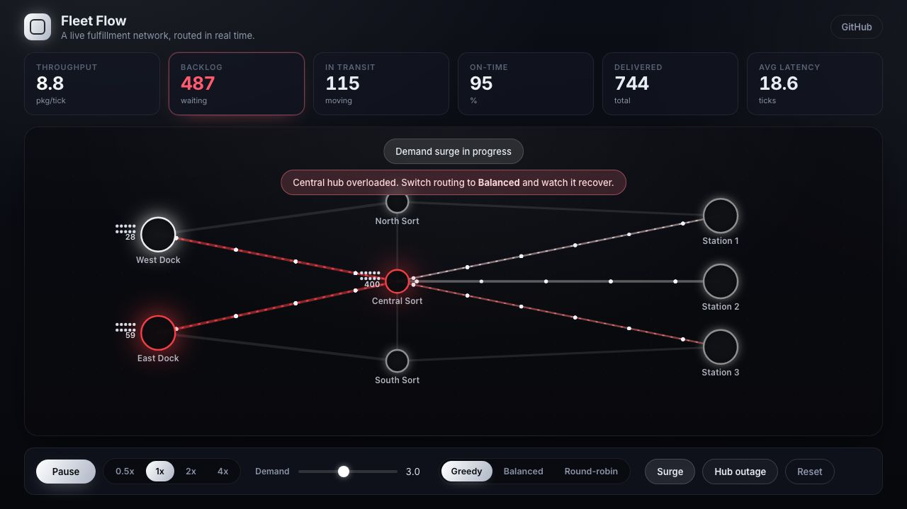
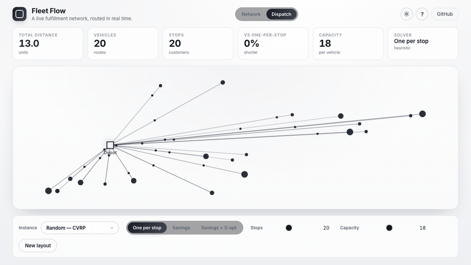
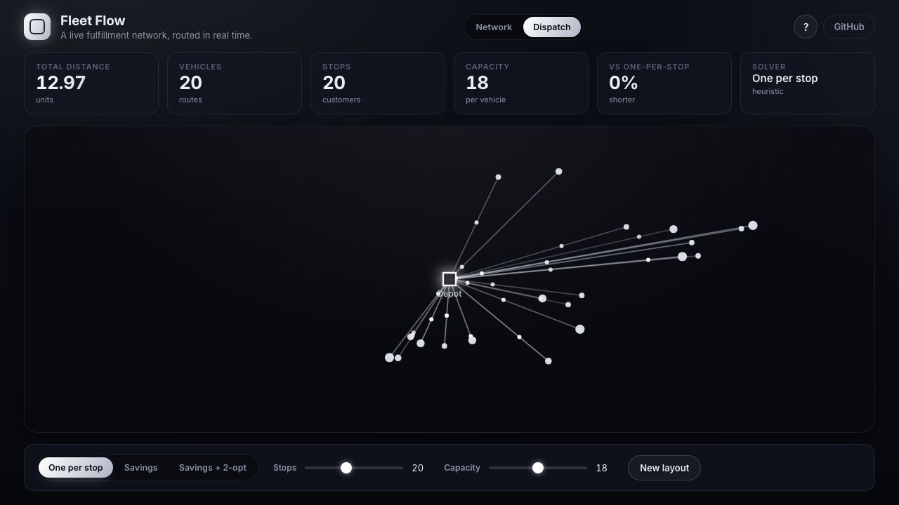
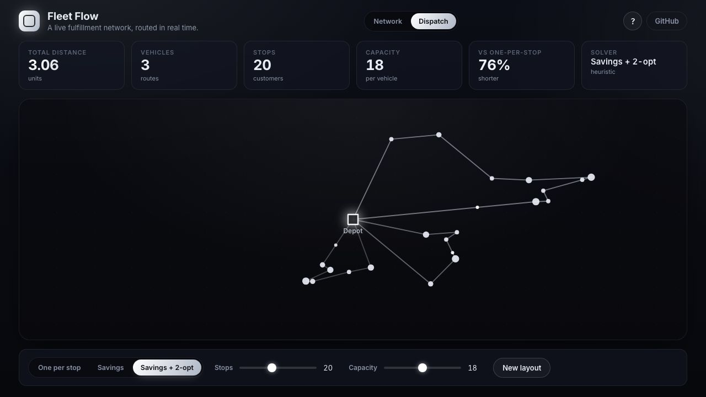
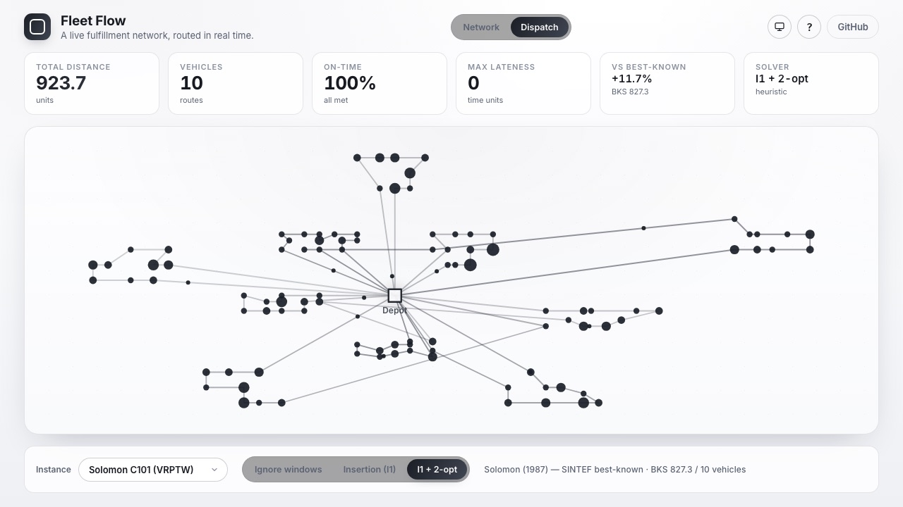
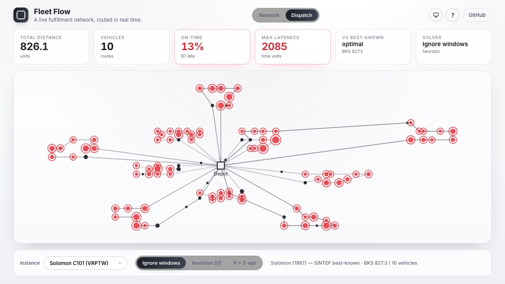
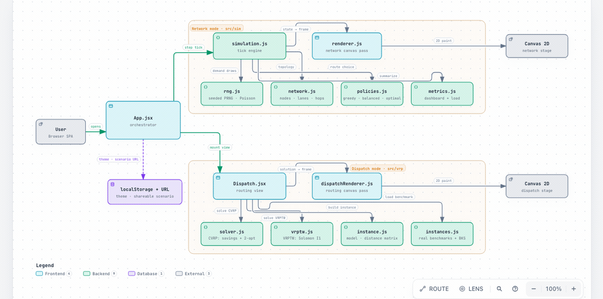

<div align="center">

# Fleet Flow

### A live fulfillment network, routed in real time.

Build a network of fulfillment centers and lanes, pour demand through it, and watch throughput, backlog, and bottlenecks form in front of you. Then change the routing policy and watch the same network either hold or collapse.

<br />

[**▶ Live demo**](https://technomad641.github.io/FleetFlow/) &nbsp;·&nbsp; [Design doc](DESIGN.md)

<br />


<br />



<sub>The guided tour, start to finish: Balanced routing holding the network, the Greedy surge collapse (red is the only color on screen, and it always means congestion), then the Gauntlet network where the whole-path Optimal router pulls ahead.</sub>

</div>

---

## The idea

Every destination in the network is reachable through one central hub. It is the shortest path to almost everywhere, so a routing policy that only minimizes distance funnels everything onto it. The hub has a fixed service rate. Under a demand surge it chokes, backlog explodes, and on-time delivery falls off a cliff.

A congestion-aware policy makes a different call: push some traffic the "longer" way through the north and south hubs, which have spare capacity, and the network keeps flowing.

Same network. Same demand. The routing decision is the difference between holding and collapsing. That decision, made thousands of times a second across a real fulfillment network, is the problem this simulates.

The contrast is pinned as a test. On an identical heavy demand stream:

| Routing policy | Backlog | Throughput | On-time |
| --- | --- | --- | --- |
| Greedy (shortest path) | **509** waiting | 9.0 pkg/tick (choked) | **47%** |
| Balanced (congestion-aware) | **12** waiting | 10.1 pkg/tick | **100%** |

## The two states

<table>
<tr>
<td width="50%"></td>
<td width="50%"></td>
</tr>
<tr>
<td align="center"><strong>Balanced</strong> — the network flows, on-time holds at 100%.</td>
<td align="center"><strong>Greedy + surge</strong> — the central hub chokes and the arteries turn red.</td>
</tr>
</table>

## Does smarter routing help? A benchmark

`bun run bench` runs every policy on the exact same seeded demand across a sweep of load levels, for each network. Because the simulation is deterministic, any difference is the routing decision and nothing else.

**Atlas (the shallow network), demand 6.0 pkg/tick per source:**

| Policy | Delivered | Backlog | On-time |
| --- | --- | --- | --- |
| Greedy (shortest path) | 5,299 | 1,973 | **14%** |
| Round-robin | 6,521 | 746 | **45%** |
| Balanced (congestion-aware) | 7,247 | 17 | **100%** |
| Optimal (whole-path) | 7,234 | 17 | **100%** |

On Atlas, congestion-awareness is the whole game: the load-blind policies collapse, the congestion-aware ones hold. But Optimal only *matches* Balanced. The network is shallow enough that backpressure makes one-hop sensing sufficient, so whole-path routing has nothing extra to exploit. Knowing that a simple heuristic already suffices here is the point.

**Gauntlet (a deeper, adversarial network):** two sources reach two stations by either a fast-but-small Express hub or a slow-but-fat Local hub. Here the policies come apart:

| Policy | On-time @ low load | On-time @ high load | Backlog @ high load |
| --- | --- | --- | --- |
| Greedy | 100% | **5%** | 1,459 |
| Balanced | **47%** | 45% | 18 |
| Optimal | **93%** | **57%** | 18 |

- **Greedy** is fastest while the Express lanes have room, then collapses when they saturate — it refuses the slow overflow.
- **Balanced** is robust but mediocre everywhere: it scores lanes by load, not transit time, so it floods the fat-but-slow Local lanes and misses most deadlines.
- **Optimal** is the only policy that is never bad. It weighs transit time against congestion over the whole path, fills the fast lanes, and spills to the slow ones only when it must.

The honest takeaway: a sophisticated optimizer is worth building, but you have to know when it pays off. On a shallow network a simple heuristic already wins; on a deeper one the whole-path optimizer pulls clearly ahead. Switch networks in the app and toggle policies to watch it happen.

## Dispatch mode: classic vehicle routing

Switch to **Dispatch** in the header for the other half of the routing story: the vehicle routing problem. A depot, a set of customers each with a demand, and a fleet of fixed-capacity trucks that must serve everyone and return home, minimizing total distance. It is NP-hard, so the solver uses heuristics you can switch live. Pick a random layout you can resize, or one of three real published benchmarks.



<sub>One truck per stop → Clarke-Wright savings + 2-opt tightens it to a handful of loops → the real Solomon C101 benchmark, 10 trucks all on time → switch to "ignore windows" and the same stops, served in a shorter but clock-blind order, flood red: 87 of 100 deadlines missed.</sub>

### CVRP — capacity only

- **One per stop** — the trivial baseline: a separate truck for every customer.
- **Savings** — Clarke-Wright parallel savings, the classic CVRP construction heuristic: merge the routes whose endpoints are cheapest to join, respecting capacity.
- **Savings + 2-opt** — then run 2-opt within each route to undo crossings.

On a 20-customer instance (capacity 18):

| Solver | Vehicles | Total distance | vs one-per-stop |
| --- | --- | --- | --- |
| One per stop | 20 | 12.97 | — |
| Savings + 2-opt | **3** | **3.06** | **76% shorter** |

<table>
<tr>
<td width="50%"></td>
<td width="50%"></td>
</tr>
<tr>
<td align="center"><strong>One per stop</strong> — 20 trucks, a starburst.</td>
<td align="center"><strong>Savings + 2-opt</strong> — 3 trucks, tight loops.</td>
</tr>
</table>

### VRPTW — capacity *and* a deadline per stop

Real deliveries have appointment windows. The VRPTW adds a hard `[ready, due]` window and a service time to every customer, and a working day to the depot. A truck can arrive early and wait, but it cannot serve a stop after its window closes. Now the **visit order** decides feasibility, not just distance, so Clarke-Wright no longer applies. The solver uses the classic VRPTW pipeline:

- **Ignore windows** — the CVRP route, scheduled against the clock. Usually *shorter* and usually *late*: the honest baseline for what ignoring the clock costs.
- **Insertion (I1)** — Solomon's I1 sequential insertion (1987): grow one route at a time, inserting the customer whose best feasible insertion is most worth it.
- **I1 + 2-opt** — then a time-feasible 2-opt that only accepts a reversal if the route stays on time.

A stop served after its window closes is ringed in red. On Solomon C101 (100 customers), "Ignore windows" finds a route that is **shorter** than the on-time one (826 vs 924) and misses **87 of 100 deadlines**:

<table>
<tr>
<td width="50%"></td>
<td width="50%"></td>
</tr>
<tr>
<td align="center"><strong>I1 + 2-opt</strong> — 10 trucks, 100% on time.</td>
<td align="center"><strong>Ignore windows</strong> — shorter, but 87/100 stops late (red).</td>
</tr>
</table>

### Measured against real benchmarks

Three canonical instances ship with the app, embedded verbatim from their published sources, each with its best-known solution (BKS). The solvers are construction-grade, so they do not match BKS, but every solution is valid (covers all customers, respects capacity, and for VRPTW meets every window) and lands close:

| Instance | Type | Solver | Result | BKS | Gap |
| --- | --- | --- | --- | --- | --- |
| Augerat A-n32-k5 | CVRP | Savings + 2-opt | 829, 5 trucks | 784, 5 | **+5.7%** |
| Solomon C101 | VRPTW | I1 + 2-opt | 924, 10 trucks, on time | 827.3, 10 | **+11.7%** |
| Solomon R101 | VRPTW | I1 + 2-opt | 1873, 21 trucks, on time | 1650.8, 19 | **+13.4%** |

Augerat uses TSPLIB integer-rounded distances (so the number is comparable to its BKS of 784); Solomon uses exact Euclidean distance as travel time, the standard convention.

The solvers are pure and tested (every customer covered once, capacity respected, 2-opt never regresses, the CVRP solver reaches the known optimum on a hand-built instance, the VRPTW scheduler catches every late arrival, and all three real instances solve to valid solutions inside a band around BKS). They live in `src/vrp/` and are independent of the live simulation; the two modes share only the app shell and the design system.

## Features

- **Real-time discrete-event simulation** of a fulfillment network: sources emit bursty (Poisson) demand, hubs route it, sinks consume it.
- **Four routing policies** you can switch live: greedy (shortest path), balanced (congestion-aware), optimal (whole-path, congestion-priced), and round-robin.
- **Two networks** you can switch live: Atlas (where a one-hop heuristic suffices) and Gauntlet (a deeper network where the whole-path optimizer wins).
- **Guided tour + legend** — a first-run intro and a nine-step walkthrough that drives the sim from Balanced to the Greedy surge collapse to the Gauntlet optimizer win, so anyone gets the story in under a minute.
- **Shareable scenario links** — the URL always reflects the current view, so you can link straight to a specific setup (say, [Gauntlet + Optimal at 2x](https://technomad641.github.io/FleetFlow/?net=gauntlet&policy=optimal&demand=3.5&speed=2)). Decoding is defensive, so a hand-edited link can never break the app.
- **Two modes** — Network (the live simulation above) and Dispatch (a vehicle-routing solver: CVRP and VRPTW with time windows, including three real published benchmarks measured against their best-known solutions), switchable in the header.
- **Light and dark themes** — a system / light / dark toggle in the header. The whole visual language inverts correctly, canvases included (the grayscale load ramp flips white-on-dark to black-on-light); red stays the one alert color in both.
- **Scenario injection**: fire a demand surge or take a hub offline and watch the network react and recover.
- **Live instrumentation**: throughput, backlog, in-transit, on-time rate, delivered total, average latency.
- **Deterministic and reproducible**: the entire run is a pure function of its seed, so a scenario replays identically and two policies can be compared on the exact same demand.
- **60fps canvas rendering** decoupled from the simulation tick, with smooth interpolation.

## Quick start

Requires [Bun](https://bun.sh) or Node 18+.

```bash
bun install
bun run dev        # http://localhost:5173
```

With npm:

```bash
npm install
npm run dev
```

Other scripts:

```bash
bun run test       # run the simulation test suites
bun run build      # run tests, then build to dist/ (a red test fails the build)
bun run preview    # serve the production build
```

## How it works

The simulation advances one tick at a time. Each tick, in order:

1. **Demand** — every source emits a Poisson-distributed batch of packets, each addressed to a random delivery station.
2. **Dispatch** — each node pushes queued packets onto outgoing lanes, up to its service rate. Lanes have a per-tick intake cap, so a full lane applies backpressure and backlog builds at the node behind it.
3. **Advance** — packets that have crossed their lane's transit time arrive at the next node, and are either delivered (at their destination) or re-queued for the next hop.
4. **Accounting** — throughput window, latency, and on-time counters update.

A **routing policy** is just a function: given a packet at a node, which outgoing lane sends it closer to its destination? Every policy only considers lanes that reduce the hop distance to the destination, so routing always terminates. They differ only in how they choose among those lanes, and that is the whole story.

The **renderer** is a pure drawing pass over simulation state. It runs at the display refresh rate and interpolates packet positions between sim ticks using a fractional tick value, so motion is smooth even though the simulation steps at a fixed, slower rate.

## Architecture



<sub>App.jsx is the only stateful layer. It switches two modes, each a cluster of pure modules: Network (seeded simulation + four routing policies → `renderer.js`) and Dispatch (CVRP/VRPTW solvers + real benchmarks → `dispatchRenderer.js`). No backend; localStorage holds the theme and the URL carries a shareable scenario. · <a href="https://technomad641.github.io/FleetFlow/architecture.html"><strong>Open the interactive diagram</strong></a> (pan, zoom, inspect each module's source).</sub>

A thin orchestrator (`App.jsx`) wires together pure, testable modules. Everything that makes a decision lives in a pure module with no DOM and no clock, so it can be unit-tested directly.

```
src/
  sim/                the live network simulation
    rng.js            seeded PRNG + Poisson demand (deterministic)
    network.js        node/lane model, BFS hop distances, the reference networks
    policies.js       greedy / balanced / optimal / round-robin routing
    simulation.js     the tick engine: demand -> dispatch -> advance -> accounting
    metrics.js        read-only dashboard + load views
  vrp/                the Dispatch mode (independent of the simulation)
    instance.js       depot/customer model, distance matrix, random CVRP + VRPTW
    solver.js         CVRP: naive / Clarke-Wright savings / 2-opt
    vrptw.js          VRPTW: schedule/feasibility, Solomon I1, time-feasible 2-opt
    instances.js      real benchmarks: Augerat A-n32-k5, Solomon C101 / R101 (+ BKS)
  render/
    renderer.js       network canvas pass (pure, reads state, never mutates)
    dispatchRenderer.js  dispatch canvas pass (depot, customers, routes, late rings)
  shareState.js       encode/decode the view into a shareable URL
  content.js          intro copy, legend, guided-tour script
  App.jsx             orchestrator: mode switch, render loop, controls
  Dispatch.jsx        the Dispatch view (instance picker, CVRP/VRPTW solvers)
  *.test.js           one suite per pure module (11 in all)
```

### Testing

There is no Jest or Vitest. Each `*.test.js` default-exports a zero-argument function that runs `node:assert` checks and throws on failure; `scripts/run-tests.mjs` runs them all, and `bun run build` runs the suite before building, so a red test fails the build.

The suites cover the things that actually matter for a simulation: RNG determinism and Poisson distribution, network validation and reachability, that every policy routes toward the destination, that the engine conserves packets and fully drains when demand stops, and that balanced strictly beats greedy under congestion.

## Roadmap

- **Phase 2a (done)** — a whole-path, congestion-priced optimal router added as a fourth policy, plus a deterministic benchmark harness (`bun run bench`). See the benchmark above.
- **Phase 2b (done)** — a "Gauntlet" network: a deeper, adversarial topology where one-hop balancing is provably suboptimal and the whole-path optimizer wins decisively. Switchable live in the app.
- **Phase 2c (done)** — a separate "Dispatch" mode: capacitated vehicle routing with Clarke-Wright construction and 2-opt local search, switchable live.
- **Phase 2d (done)** — time windows (VRPTW) with Solomon I1 insertion and a time-feasible 2-opt, plus three real published benchmarks (Augerat A-n32-k5, Solomon C101 and R101) embedded and measured against their best-known solutions.
- **Phase 3** — real road distances and maps, richer network editing.
- Saved named scenarios.

## Tech stack

React 18 + Vite, Canvas 2D, a zero-dependency test runner. No animation or state libraries: the simulation and the rendering are hand-built, which is the point.

## License

MIT © 2026 Rajat Singh
